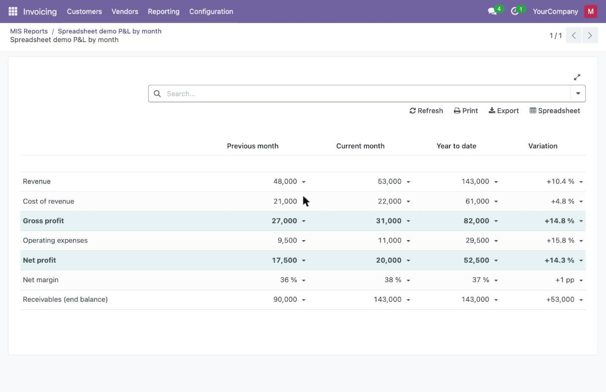
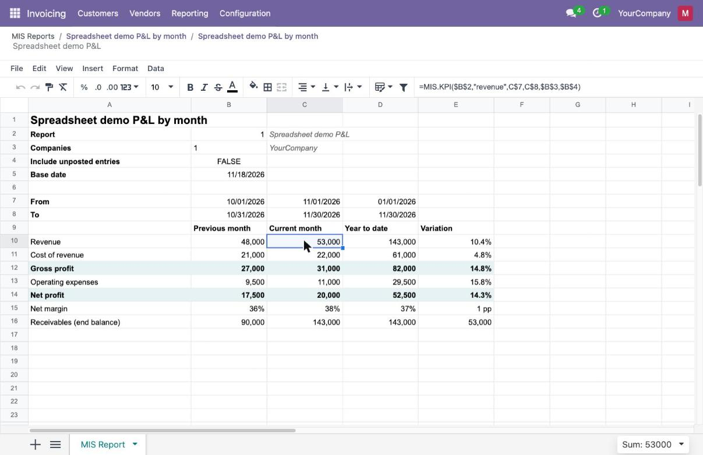
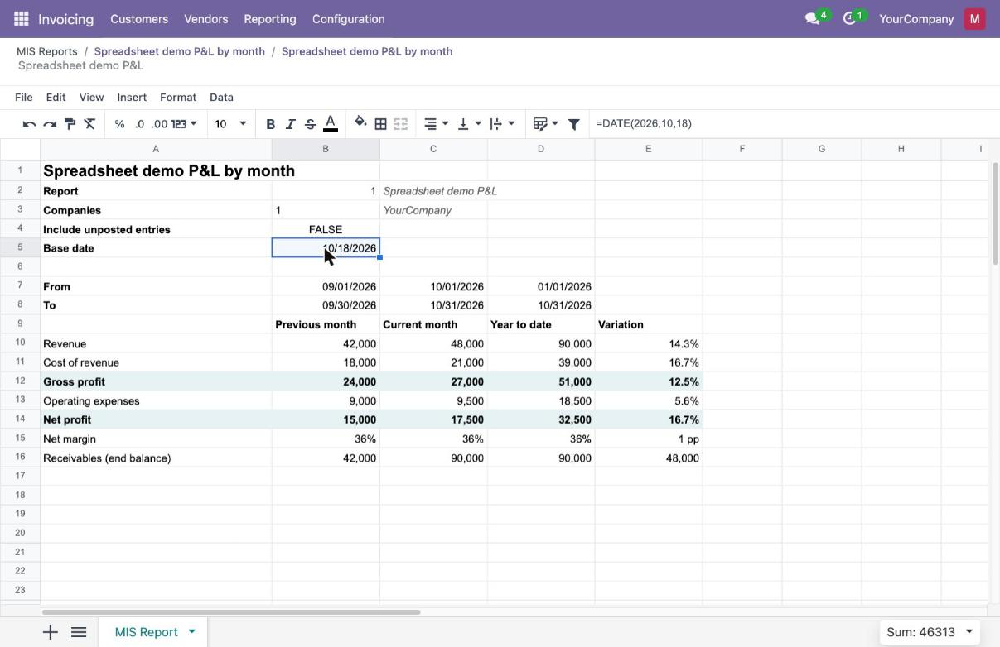

=======================
Spreadsheet MIS Builder
=======================

.. 
   !!!!!!!!!!!!!!!!!!!!!!!!!!!!!!!!!!!!!!!!!!!!!!!!!!!!
   !! This file is generated by oca-gen-addon-readme !!
   !! changes will be overwritten.                   !!
   !!!!!!!!!!!!!!!!!!!!!!!!!!!!!!!!!!!!!!!!!!!!!!!!!!!!
   !! source digest: sha256:e0692bac1843b77b0af91ef74eb1e8c46b07f174602391ba28e5ce12866c6fad
   !!!!!!!!!!!!!!!!!!!!!!!!!!!!!!!!!!!!!!!!!!!!!!!!!!!!

.. |badge1| image:: https://img.shields.io/badge/maturity-Beta-yellow.png
    :target: https://odoo-community.org/page/development-status
    :alt: Beta
.. |badge2| image:: https://img.shields.io/badge/licence-AGPL--3-blue.png
    :target: http://www.gnu.org/licenses/agpl-3.0-standalone.html
    :alt: License: AGPL-3
.. |badge3| image:: https://img.shields.io/badge/github-OCA%2Fspreadsheet-lightgray.png?logo=github
    :target: https://github.com/OCA/spreadsheet/tree/18.0/spreadsheet_mis_builder
    :alt: OCA/spreadsheet
.. |badge4| image:: https://img.shields.io/badge/weblate-Translate%20me-F47D42.png
    :target: https://translation.odoo-community.org/projects/spreadsheet-18-0/spreadsheet-18-0-spreadsheet_mis_builder
    :alt: Translate me on Weblate
.. |badge5| image:: https://img.shields.io/badge/runboat-Try%20me-875A7B.png
    :target: https://runboat.odoo-community.org/builds?repo=OCA/spreadsheet&target_branch=18.0
    :alt: Try me on Runboat

|badge1| |badge2| |badge3| |badge4| |badge5|

This module brings `MIS Builder <https://github.com/OCA/mis-builder>`__
KPIs into spreadsheets:

- a ``MIS.KPI`` spreadsheet function returns the value of a KPI of a MIS
  report template over any period;
- a *Spreadsheet* button on MIS report instances creates a spreadsheet
  reproducing the report, where every KPI cell is a live formula.

The data source is the report template (``mis.report``), not the report
instance: periods, companies and options are plain cells of the
spreadsheet, so they can be changed, computed or copied like any other
cell.

**Table of contents**

.. contents::
   :local:

Usage
=====

From a MIS report
-----------------

Open a MIS report (*Accounting > Reporting > MIS Reports*) and click
*Spreadsheet*, either on the form or on the preview.

|MIS report with the Spreadsheet button|

A new spreadsheet is created with:

- the parameters at the top: report template, companies, whether
  unposted entries are included, and the base date;
- one column per column of the report, with its *From* and *To* dates.
  Columns with relative periods are formulas based on the base date:
  change the base date and the whole report moves;
- one row per KPI, with the style and number format of the report. Each
  cell is a ``MIS.KPI`` formula;
- sum and comparison columns as plain cell formulas (``=C10-B10``), that
  can be read and changed.

|Spreadsheet created from a MIS report|

Changing the base date recomputes the periods and all the KPIs:

|Same spreadsheet with another base date|

The spreadsheet does not depend on the report instance anymore: it only
refers to the report template.

The MIS.KPI function
--------------------

``MIS.KPI(report, kpi, date_from, [date_to], [company_ids], [include_unposted], [subkpi])``

- ``report``: id of the MIS report template;
- ``kpi``: technical name of the KPI;
- ``date_from``, ``date_to``: the period. When ``date_to`` is empty,
  ``date_from`` can be a whole period: ``"2026"``, ``"Q1/2026"`` or
  ``"03/2026"``;
- ``company_ids``: ids of the companies separated by commas (the current
  company when empty);
- ``include_unposted``: ``TRUE`` to include unposted entries;
- ``subkpi``: technical name of the sub-KPI, for reports with sub-KPIs.

Examples:

- ``=MIS.KPI(1, "revenue", "2026")``
- ``=MIS.KPI(1, "revenue", B1, B2)`` with dates in ``B1`` and ``B2``
- ``=MIS.KPI(1, "revenue", ODOO.FISCALYEAR.START(B2), B2)`` for a year
  to date value

All the cells of a spreadsheet are fetched in one request, and the
server evaluates each report once per period, whatever the number of
KPIs.

Demo data
---------

With demo data, the *Spreadsheet demo P&L by month* MIS report and the
spreadsheet created from it are available. They rely on a few demo
journal entries of the last three months, posted on dedicated accounts
(codes starting with ``SMB``).

Known issues / Roadmap
======================

- Columns that ``MIS.KPI`` can not reproduce are exported as static
  values, and flagged as such in their header: analytic filters,
  alternative move line sources and budgets (``mis_builder_budget``).
- Details by account are not exported.
- Rows hidden when empty are evaluated at export time only.
- The divider, prefix and suffix of MIS styles are not converted.
- The export always creates a new spreadsheet: inserting into an
  existing one is not supported.
- No autocompletion of report and KPI names, no drill-down to journal
  items from a cell, and no side panel to manage the parameters.
- The base date is a cell; it is not linked to the global filters of the
  spreadsheet.

Bug Tracker
===========

Bugs are tracked on `GitHub Issues <https://github.com/OCA/spreadsheet/issues>`_.
In case of trouble, please check there if your issue has already been reported.
If you spotted it first, help us to smash it by providing a detailed and welcomed
`feedback <https://github.com/OCA/spreadsheet/issues/new?body=module:%20spreadsheet_mis_builder%0Aversion:%2018.0%0A%0A**Steps%20to%20reproduce**%0A-%20...%0A%0A**Current%20behavior**%0A%0A**Expected%20behavior**>`_.

Do not contact contributors directly about support or help with technical issues.

Credits
=======

Authors
-------

* KMEE

Contributors
------------

- `KMEE <https://kmee.com.br>`__:

  - Luis Felipe Mileo <mileo@kmee.com.br>

Maintainers
-----------

This module is maintained by the OCA.

.. image:: https://odoo-community.org/logo.png
   :alt: Odoo Community Association
   :target: https://odoo-community.org

OCA, or the Odoo Community Association, is a nonprofit organization whose
mission is to support the collaborative development of Odoo features and
promote its widespread use.

This module is part of the `OCA/spreadsheet <https://github.com/OCA/spreadsheet/tree/18.0/spreadsheet_mis_builder>`_ project on GitHub.

You are welcome to contribute. To learn how please visit https://odoo-community.org/page/Contribute.
