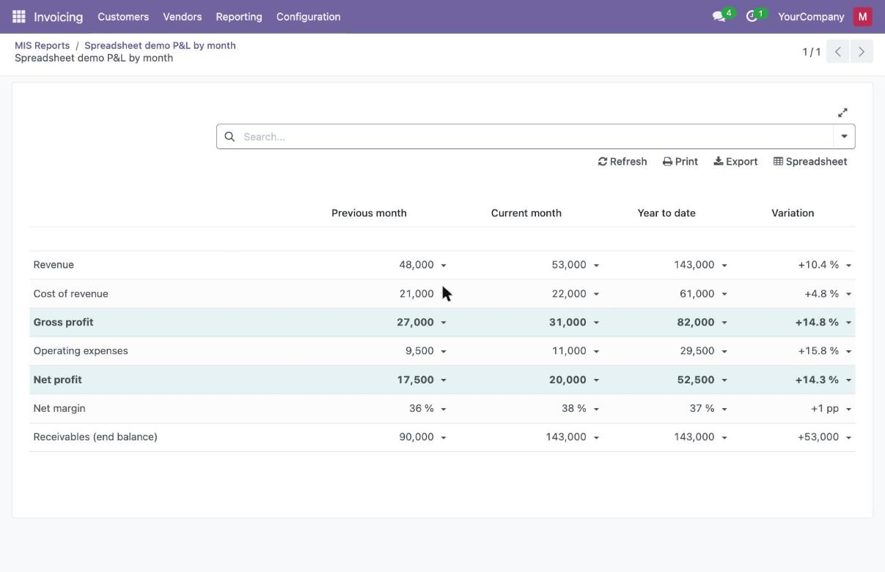
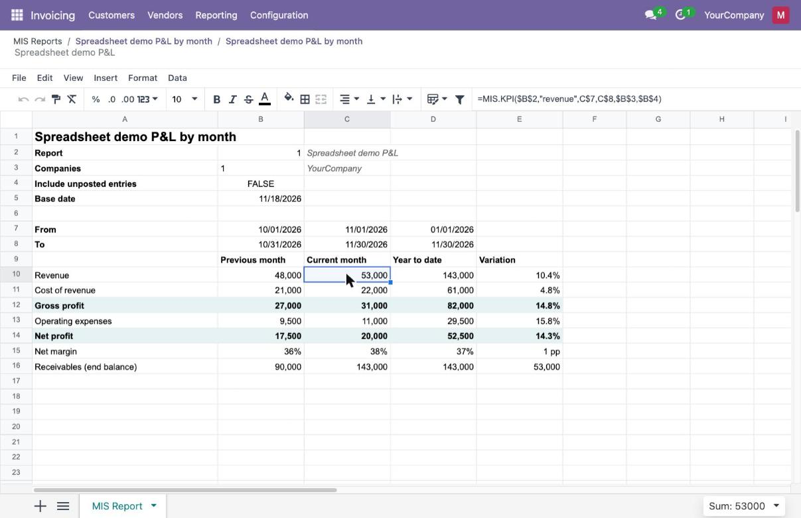
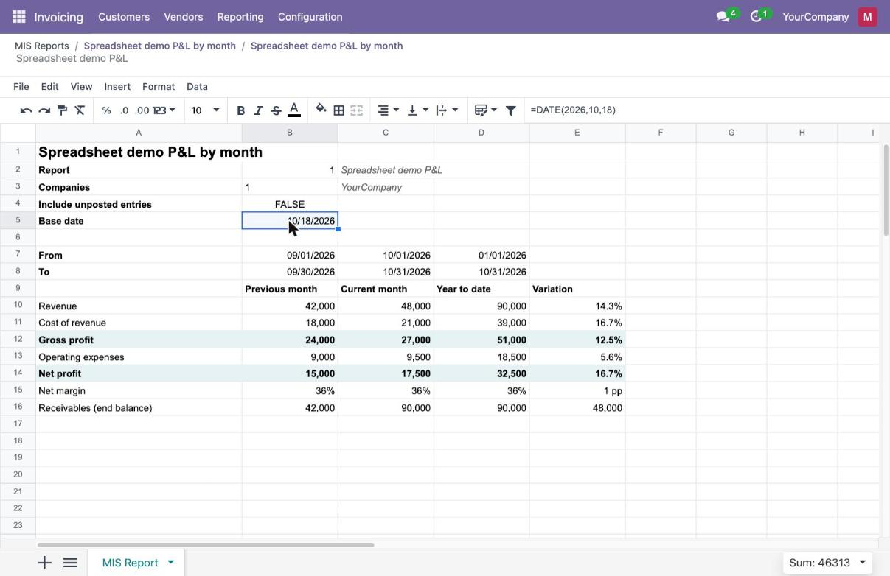

## From a MIS report

Open a MIS report (*Accounting \> Reporting \> MIS Reports*) and click
*Spreadsheet*, either on the form or on the preview.

A new spreadsheet is created with:

- the parameters at the top: report template, companies, whether
  unposted entries are included, and the base date;
- one column per column of the report, with its *From* and *To* dates.
  Columns with relative periods are formulas based on the base date:
  change the base date and the whole report moves;
- one row per KPI, with the style and number format of the report. Each
  cell is a `MIS.KPI` formula;
- sum and comparison columns as plain cell formulas (`=C10-B10`), that
  can be read and changed.

Changing the base date recomputes the periods and all the KPIs:

The spreadsheet does not depend on the report instance anymore: it only
refers to the report template.

## The MIS.KPI function

`MIS.KPI(report, kpi, date_from, [date_to], [company_ids], [include_unposted], [subkpi])`

- `report`: id of the MIS report template;
- `kpi`: technical name of the KPI;
- `date_from`, `date_to`: the period. When `date_to` is empty,
  `date_from` can be a whole period: `"2026"`, `"Q1/2026"` or
  `"03/2026"`;
- `company_ids`: ids of the companies separated by commas (the current
  company when empty);
- `include_unposted`: `TRUE` to include unposted entries;
- `subkpi`: technical name of the sub-KPI, for reports with sub-KPIs.

Examples:

- `=MIS.KPI(1, "revenue", "2026")`
- `=MIS.KPI(1, "revenue", B1, B2)` with dates in `B1` and `B2`
- `=MIS.KPI(1, "revenue", ODOO.FISCALYEAR.START(B2), B2)` for a year to
  date value

All the cells of a spreadsheet are fetched in one request, and the
server evaluates each report once per period, whatever the number of
KPIs.

## Demo data

With demo data, the *Spreadsheet demo P&L by month* MIS report and the
spreadsheet created from it are available. They rely on a few demo
journal entries of the last three months, posted on dedicated accounts
(codes starting with `SMB`).
